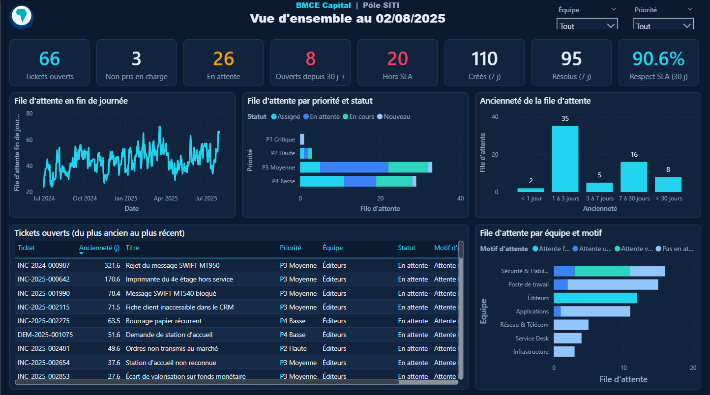
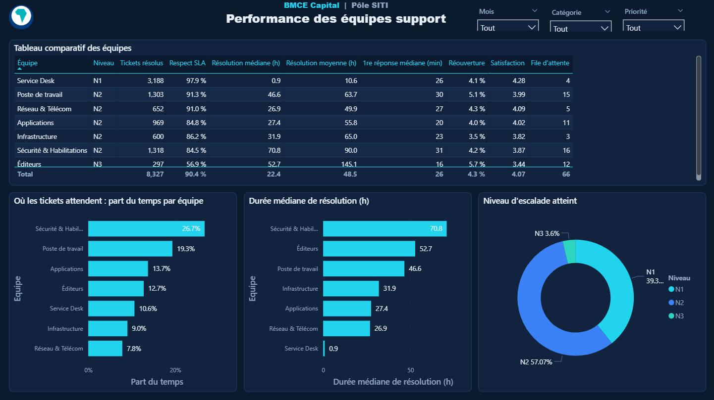

# Dashboard Helpdesk – Pôle SITI

Tableau de bord Power BI de pilotage du support informatique : ce qui se passe maintenant dans la file
d'attente, et comment chaque équipe support s'en sort (SLA, délais, satisfaction).

Période couverte : 1er juillet 2024 → 30 juillet 2025 · ~8 600 tickets · 7 équipes support (N1 → éditeurs).

> **Données simulées.** Les tickets, agents et demandeurs sont générés (script Python) pour reproduire
> un helpdesk réaliste : volumes, pics, escalades, SLA par équipe. Aucune donnée réelle ni confidentielle
> n'est utilisée ; les noms et les chiffres ne correspondent à aucune personne ni à aucun résultat réel.

## Aperçu

**Vue d'ensemble** : file d'attente au jour J, tickets bloqués ou hors SLA, activité des 7 derniers jours.



**Performance des équipes** : comparaison des équipes et temps passé par équipe.



## Power Query

- **Une fonction pour toutes les sources** : `fnLireCsv` lit chaque export (séparateur `;`, UTF-8) et
  remplace les cellules vides par `null`. Le dossier source est un paramètre (`DossierExport`).
- **Typage indépendant de la langue** : dates converties avec la culture `en-US`, pour que le rapport
  s'actualise de la même façon sur un Power BI en français ou en anglais.
- **Colonnes préparées en amont plutôt qu'en DAX** : clé catégorie, dates sans heure pour les relations,
  durée de résolution, délai de première réponse, ancienneté de la file d'attente et tranches d'âge.
- **Calendrier construit en M** : jours et mois en français, jours fériés marocains, jours ouvrés,
  périodes (Ramadan, été).
- **Historique des statuts** : pour chaque statut, la date de fin (= changement suivant du même ticket).
  La file d'attente d'un jour passé devient un simple filtre, sans recherche ligne à ligne en DAX
  (calcul sur un an : 7,5 s → 0,15 s).

## Modèle

Schéma en étoile : 4 tables de faits (tickets, historique des statuts, affectations aux équipes,
journal de chargement) et 6 dimensions (date, équipe, département demandeur, agent, catégorie, priorité).

- Relations plusieurs → un, filtrage dans un seul sens.
- `Dim_Date` filtre les tickets par **date de création** ; la relation sur la **date de résolution**
  est inactive et activée par `USERELATIONSHIP` dans les mesures de résolution.
- Aucune relation entre tables de faits, pour éviter les chemins ambigus.
- Colonnes techniques et clés masquées, tris personnalisés (mois, priorités P1 → P4, équipes N1 → N3).

## Mesures DAX

~45 mesures regroupées dans une table `Mesures` : volume, file d'attente, délais, SLA, qualité, temps par équipe,
activité récente.

```dax
-- File d'attente réelle à la fin de chaque jour, à partir de l'historique des statuts
File d'attente fin de journée =
VAR Jour = MAX ( Dim_Date[date] )
RETURN
    CALCULATE (
        COUNTROWS ( Fait_HistoriqueStatuts ),
        REMOVEFILTERS ( Dim_Date ),
        Fait_HistoriqueStatuts[est_statut_ouvert] = TRUE (),
        Fait_HistoriqueStatuts[date_changement_jour] <= Jour,
        Fait_HistoriqueStatuts[date_fin_statut_jour] > Jour
            || ISBLANK ( Fait_HistoriqueStatuts[date_fin_statut_jour] )
    )
```

```dax
-- Tickets résolus : compte à la date de résolution, pas de création
Tickets résolus =
CALCULATE (
    COUNTROWS ( Fait_Tickets ),
    USERELATIONSHIP ( Fait_Tickets[date_resolution_jour], Dim_Date[date] ),
    Fait_Tickets[est_resolu] = TRUE ()
)

Respect SLA % = DIVIDE ( [Tickets résolus] - [Tickets résolus hors SLA], [Tickets résolus] )
```

```dax
-- Temps passé par équipe pour les tickets du filtre (catégorie, priorité...), quelle que soit l'équipe finale
Temps passé - tickets filtrés (h) =
VAR Tickets = CALCULATETABLE ( VALUES ( Fait_Tickets[id_ticket] ), REMOVEFILTERS ( Dim_Equipe ) )
RETURN
    CALCULATE ( [Temps passé en équipe (h)], TREATAS ( Tickets, Fait_Affectations[id_ticket] ), REMOVEFILTERS ( Dim_Date ) )
```

Quelques chiffres sur la période : respect du SLA **90,4 %**, durée médiane de résolution **22 h**
(moyenne 48 h, tirée par les tickets éditeurs), satisfaction **4,07 / 5**.

## Ouvrir le rapport

Ouvrir `helpdesk_dashboard.pbix` avec Power BI Desktop. Les données sont incluses dans le fichier.
